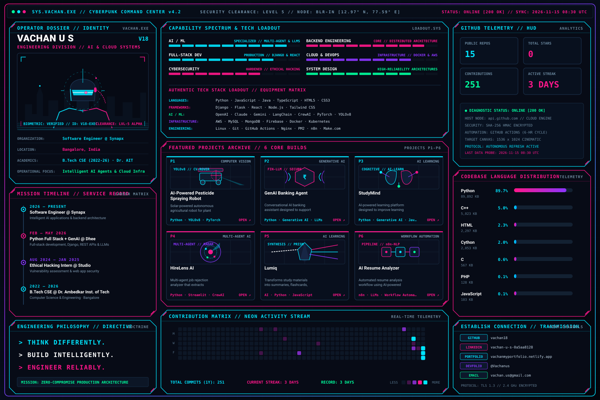
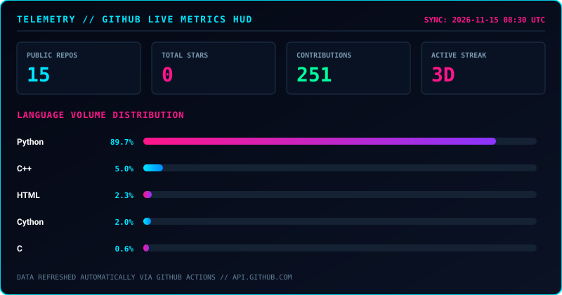

<!-- VACHAN.EXE — CYBERPUNK ENGINEERING COMMAND CENTER -->

 

<!-- SECURE CONNECTION CHANNELS -->
<a href="https://github.com/vachan18"><strong>GITHUB</strong></a> ·
<a href="https://www.linkedin.com/in/vachan-u-s-0a5aa8128"><strong>LINKEDIN</strong></a> ·
<a href="https://vachanmyportfolio.netlify.app/"><strong>PORTFOLIO</strong></a> ·
<a href="https://devfolio.co/@Vachanus"><strong>DEVFOLIO</strong></a> ·
<a href="mailto:vachan.us@gmail.com"><strong>EMAIL</strong></a>

## 🛰️ OPERATOR BRIEFING

**Vachan U S — Software Engineer @ Synapx**

Building intelligent applications, engineering reliable systems, and exploring the next generation of software.

- 📍 **Location:** Bangalore, India [12.9716° N, 77.5946° E]
- 🎓 **Education:** B.Tech Computer Science & Engineering · Dr. Ambedkar Institute of Technology · 2022–2026
- ⚡ **Core Systems:** AI Agents &amp; Multi-Agent Orchestration · Distributed Backend Infrastructure · Cloud &amp; Automation Pipelines
- 📊 **Verified Metrics:** 251 Contributions (Past Year) · 3-Day Active Streak · 15 Public Repositories

---

## 📂 PROJECT REPOSITORIES (P1 – P6)

Direct repository access for all six intelligence builds featured in the Cyberpunk Command Center:

| SYSTEM BUILD | STACK &amp; REPOSITORY SOURCE |
|---|---|
| **P1 — AI-Powered Pesticide Spraying Robot** COMPUTER VISION / IOT | `Python` · `YOLOv8` · `PyTorch` · `OpenCV` [`vachan18/AI-POWERED-PESTICIDE-SPRAYING-ROBOT-WITH-DISEASE-DETECTION ↗`](https://github.com/vachan18/AI-POWERED-PESTICIDE-SPRAYING-ROBOT-WITH-DISEASE-DETECTION) |
| **P2 — GenAI Banking Agent** GENERATIVE AI | `Python` · `Generative AI` · `LLMs` · `APIs` [`vachan18/Gen-AI-banking-agent ↗`](https://github.com/vachan18/Gen-AI-banking-agent) |
| **P3 — StudyMind** AI LEARNING | `Python` · `Generative AI` · `JavaScript` · `APIs` [`vachan18/StudyMind ↗`](https://github.com/vachan18/StudyMind) |
| **P4 — HireLens AI** MULTI-AGENT AI | `Python` · `Streamlit` · `CrewAI` · `LLMs` [`vachan18/HirelensAi ↗`](https://github.com/vachan18/HirelensAi) |
| **P5 — Lumiq** AI LEARNING | `AI` · `Python` · `JavaScript` · `APIs` [`vachan18/Lumiq---Smart-Learning-Platforms ↗`](https://github.com/vachan18/Lumiq---Smart-Learning-Platforms) |
| **P6 — AI Resume Analyzer** WORKFLOW AUTOMATION | `n8n` · `LLMs` · `Workflow Automation` [`vachan18/ai-resume-analyzer-n8n ↗`](https://github.com/vachan18/ai-resume-analyzer-n8n) |

---

## 🎖️ SERVICE RECORD &amp; CREDENTIALS

- **Software Engineer** · Synapx _(2026 – Present)_ — Software engineering and modern development workflows.
- **Python Full Stack + Generative AI** · Dhee Coding Lab _(Feb – May 2026)_ — Full-stack development, Django, REST APIs, SQL and AI-assisted development.
- **Ethical Hacking Intern** · Internship Studio _(Aug 2024 – Jan 2025)_ — Vulnerability assessment and web application security.
- **B.Tech, Computer Science &amp; Engineering** · Dr. Ambedkar Institute of Technology _(2022 – 2026)_ — Bangalore

**Technical Certifications &amp; Leadership:**
- Indo-Dutch Cyber Security School — 30 CPE credits
- Anthropic Cloud Certified Architect Foundations credential
- Organized Interrupt XIII and led a volunteer team of 20+ members

---

## ⚡ LIVE TELEMETRY &amp; CONTRIBUTION NETWORK

<!-- TELEMETRY HUD -->

  

<!-- REAL CONTRIBUTION NETWORK -->
<picture>
  <source media="(prefers-color-scheme: dark)" srcset="https://raw.githubusercontent.com/vachan18/vachan18/output/github-contribution-grid-snake-dark.svg">
  <source media="(prefers-color-scheme: light)" srcset="https://raw.githubusercontent.com/vachan18/vachan18/output/github-contribution-grid-snake.svg">
  
</picture>

---

**THINK DIFFERENTLY. BUILD INTELLIGENTLY. ENGINEER RELIABLY.**

VACHAN.EXE // CYBERPUNK COMMAND CENTER · AUTOMATED TELEMETRY REFRESH EVERY 6 HOURS

