<!--
  Every card below is an animated SVG drawn by scripts/render_readme_cards.py
  and refreshed daily by .github/workflows/update-profile-art.yml.
  Keep this block free of blank lines, and keep each row of three cards on ONE
  line with no spaces between the tags, or GitHub will break the row.
-->

<picture><source media="(prefers-color-scheme: dark)" srcset="./cards/title-coding-dark.svg"/></picture>

<a href="https://vachanportfolio.sryze.cc">Portfolio</a> ·
<a href="https://www.linkedin.com/in/vachan-u-s-0a5aa8128/">LinkedIn</a> ·
<a href="https://devfolio.co/@Vachanus">Devfolio</a> ·
<a href="mailto:vachan.us@gmail.com">Email</a>

