<!--
  Every card below is an animated SVG drawn by scripts/render_readme_cards.py
  and refreshed every 2 hours by .github/workflows/update-profile-art.yml.
  Keep this block free of blank lines, and keep each row of cards on ONE
  line with no spaces between the tags, or GitHub will break the row.
  Every card, including the "What I'm coding" title, has its own background,
  so nothing depends on GitHub's theme or on dark-mode browser extensions.
-->

